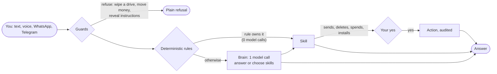

<p align="center">
  
  
</p>

<h3 align="center">A private, safety-first personal AI assistant for Windows</h3>

<p align="center">
  <a href="https://github.com/ishtiaq-ahmed-dev/ISHTI/actions/workflows/ci.yml"></a>
  
  
  
  <a href="LICENSE"></a>
</p>

ISHTI is a desktop assistant that you can type to or talk to. It runs on your own PC. It answers questions, keeps
reminders and notes, finds and reads your files, works with your Gmail, Calendar, WhatsApp and Telegram, and
translates to and from Urdu and Pashto. It never acts behind your back: anything that sends, deletes, spends or
installs waits for your explicit **yes**, and some actions, such as wiping a drive or moving money, are refused outright.

It is **single-owner by design**: one person, one PC, one memory.

---

## Highlights

- **One decision per request.** Deterministic rules handle what they can with no model call. Everything else gets
  **at most one** model call, which either answers or picks the right skill. Ordinary turns cost 0–1 calls.
- **Your choice of brain.** A local model through [Ollama](https://ollama.com), or any OpenAI-compatible cloud API
  (OpenAI, Anthropic, Gemini, OpenRouter, AgentRouter, or a custom URL). If the cloud refuses, **automatic failover**
  switches to a light local model, and a circuit breaker stops ISHTI from retrying a dead provider on every message.
- **About 120 skills:** reminders, calendar, notes, files, documents (PDF, Word, Excel, slides), charts, OCR, media,
  translation, web search with citations, markets, ledger, a CRM-style Business Desk, and more.
  See [docs/SKILLS.md](docs/SKILLS.md).
- **Real integrations, not screen scraping.** Gmail and Google Calendar through their official APIs (OAuth),
  Telegram through the Bot API, and WhatsApp through [WAHA](https://waha.devlike.pro), a local HTTP API.
  No headless browser drives your accounts.
- **Voice.** Optional wake word, Whisper speech-to-text and Kokoro text-to-speech, all on-device. The microphone
  is off by default.
- **Learns from you, safely.** Corrections become lessons and preferences, which you can inspect and delete under
  *Learning*. Model weights are never changed at runtime.
- **Token-efficient.** The system prompt is ordered for provider prompt caching (stable prefix first). Measured
  facts about your PC are only attached when you ask about it, and background extractors skip ordinary task messages.

## How it works



| Layer | Where | What it guarantees |
|---|---|---|
| Guards | `ishti/dispatcher.py` | Hard boundaries run before any model call; injected "skip confirmation" text is refused |
| Rules | `ishti/tool_routing.py` | A skill whose own trigger owns the request runs directly |
| Brain | `ishti/brain.py` | One model call over a shortlist of at most 12 skills; multi-step plans become a journaled workflow |
| Execution | `ishti/skill_execution.py` | Tier gates (T0 read-only to T3 blocked), scope checks, single-use approvals, audit log |
| Models | `ishti/llm.py` | One code path for local and cloud models: GPU governor, failover, kill switch, output caps |

Deeper dives: [docs/ARCHITECTURE.md](docs/ARCHITECTURE.md), [docs/SAFETY.md](docs/SAFETY.md),
[docs/API_CONTRACT.md](docs/API_CONTRACT.md).

## Quick start

**Requirements:** Windows 10 or 11 and Python 3.11. For **local** models, an NVIDIA GPU (8 GB minimum, 16 GB
recommended). For **API** mode, an API key. Docker Desktop is needed only if you want WhatsApp.

```bat
git clone https://github.com/ishtiaq-ahmed-dev/ISHTI.git C:\ISHTI
cd C:\ISHTI
install.bat              :: or: install.bat --provider api   (lightweight, no GPU models)
start.bat
```

On first start, ISHTI asks how it should think, **Local** or **API**, and saves the choice. API keys go to the
**Windows Credential Manager**, never to a file.

### Model providers

| Mode | Runs on | Configure |
|---|---|---|
| Local | Ollama on this PC, with the GPU governed so models never spill to the CPU | `install.bat` downloads the models |
| API | `openai`, `anthropic`, `gemini`, `openrouter`, `agentrouter`, or any OpenAI-compatible `base_url` | First-run card, or `llm.api` in [`ishti/config.json`](ishti/config.json) |

```jsonc
"llm": {
  "provider": "api",
  "api": {
    "provider": "agentrouter",           // or openai | anthropic | gemini | openrouter
    "model": "gpt-6.1-sol",
    "api_key_env": "ISHTI_API_KEY",      // or save the key from the first-run card (Credential Manager)
    "failover_local_model": "gemma3:4b"  // answers while the cloud refuses; "" disables failover
  }
}
```

Provider failures (bad key, quota, network, a client allow-list) are reported as one plain sentence. Failover only
uses a model Ollama **already** has pulled; it never downloads or starts anything heavy.

### WhatsApp (optional)

ISHTI runs [WAHA](https://waha.devlike.pro) in its **own** Docker container, `ishti-waha`. The container listens on
`127.0.0.1:3747` only, the image is pinned by digest, and the GOWS engine runs without a browser. Open
**Settings → Connectors → WhatsApp → Link** and scan the QR code with *WhatsApp → Linked devices*. The API key is
generated once and stored in Credential Manager; the container only receives its SHA-512 hash. ISHTI stops the
container on shutdown, and the session survives in a Docker volume.

> WhatsApp access is unofficial (WhatsApp Web protocol). It can get a number banned. Use a number you can afford to lose.

### Gmail, Calendar, Telegram

Connect them under **Settings → Connectors**. Google services use OAuth with PKCE ([docs/OAUTH_SETUP.md](docs/OAUTH_SETUP.md)).
Telegram uses a bot token and a one-time pairing code.

## Try it

```text
remind me tomorrow at 9 to submit the report
what's the weather in Peshawar this weekend?
convert 10 km to miles and what is 15% of 2400?
find my files named invoice
summarize https://www.python.org/downloads/
translate "good morning, how are you?" into Urdu
send "running 10 minutes late" to Ahmed on WhatsApp      ← shows the draft and waits for your yes
```

## Safety and privacy

- **Approvals.** T2 actions (send, delete, pay, install, control the PC) need your yes. That yes is single-use and
  bound to the exact draft and recipient. T3 actions are refused.
- **Untrusted content stays data.** Web pages, files, emails and messages can never authorise an action.
- **Local by default.** The backend binds to `127.0.0.1`. Remote access is opt-in and authenticated.
- **No secrets in files.** Keys live in Credential Manager. The API token file is owner-only.
- **Auditable.** Every action is logged with who started it. `tools/privacy_report.py` lists every host the code can
  reach and why.
- **Kill switch.** One control stops all running work at the next step.

Report vulnerabilities privately: see [SECURITY.md](SECURITY.md).

## Development

```bat
python -m venv venv && venv\Scripts\pip install -r requirements.txt
set ISHTI_OFFLINE_EVAL=1
venv\Scripts\python -m pytest              :: offline suite: no model, no network, scratch data
venv\Scripts\ruff check ishti tests
cd interface\app && npm ci && npm run build
```

Tests never touch your real data, saved provider choice or Credential Manager. See [CONTRIBUTING.md](CONTRIBUTING.md)
and [docs/TESTING.md](docs/TESTING.md).

```text
ishti/            core: dispatcher, brain, routing, LLM, memory, learning, channels, skills/
interface/        FastAPI server (web_ui/) and the React dashboard (app/)
desktop/          pywebview window, tray, launcher
orchestrator/     research engine, persona, diagnostics
tools/            installer, web search/fetch, privacy report, QA harnesses
tests/            offline pytest suite, per-skill suites, task suites
docs/             architecture, safety, API contract, setup guides
```

## Known limitations

- **Windows only**, tested on one NVIDIA card. Other hardware is unverified.
- **Accuracy is only partly measured.** See [docs/ACCURACY.md](docs/ACCURACY.md). Small local models make more
  mistakes than cloud models; check important answers.
- Pages that only render with JavaScript or sit behind a login can't be read: there is no browser automation, by design.
- Uploaded files are not encrypted at rest yet.

## License

[PolyForm Noncommercial 1.0.0](LICENSE). Free for personal and non-commercial use. Third-party notices are in
[THIRD_PARTY_NOTICES.md](THIRD_PARTY_NOTICES.md), and the release history is in [CHANGELOG.md](CHANGELOG.md).

Created by **[Ishtiaq Ahmed](https://github.com/ishtiaq-ahmed-dev)**.
