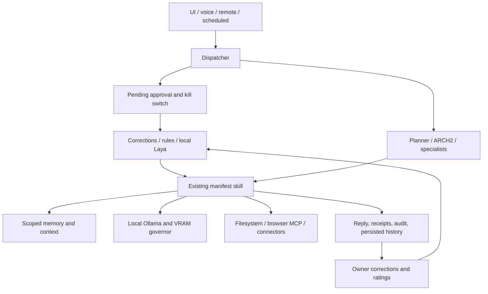

# Project map

Audit base: `e9d2559`; started 2026-10-05, continued 2026-10-06 (Asia/Karachi). Source inspection only; Windows/GPU/Chrome Profile 9 are **NEEDS PC VERIFY**.

126 tracked manifests: 125 ordinary skill folders and 1 draft manifest. Manifest status is a declaration, not a live verification result. Ordinary tier counts: T0=68, T1=42, T2=15.

## Module and entry-point map

| Area | Entry points / implementation | Responsibility |
|---|---|---|
| Startup | `start.bat; ishti/__main__.py; desktop/launcher.py; ishti/lifecycle.py` | FastAPI on loopback :8888, local Ollama startup, parallel readiness stages, desktop shell. |
| UI/API | `interface/web_ui/server.py; interface/app/src/App.tsx; src/sections/Chat.tsx; ishti/lifecycle_api.py` | React dashboard, chat sessions, HTTP and /ws, /ws/live, /ws/events. API contract currently 2.0.0. |
| Dispatcher | `ishti/dispatcher.py; ishti/skills/__init__.py` | Central request cascade, pending confirmation, routing, skill result finalization and persisted conversations. |
| Router | `ishti/router.py; ishti/corrections.py; ishti/reflex.py` | Owner corrections, deterministic skill matches, cached local Laya, chat fallback. |
| Planning/tools | `ishti/planner.py; ishti/arch2/pipeline.py; ishti/agents.py; ishti/core/tools.py` | Compound request split, {prev} chaining, specialist execution, local-model tool loops and validation. |
| Memory | `ishti/facts.py; ishti/semantic.py; ishti/rgraph.py; ishti/arch2/memory.py; ishti/core/state.py; orchestrator/memory/` | SQLite facts and conversations, Chroma recall, relationship graph, layered memories, dialogue resolution. |
| Learning | `ishti/learning/; ishti/answer_feedback.py; ishti/corrections.py; ishti/ftlog.py; orchestrator/finetune.py` | Corrections, owner ratings, lessons/rewards, reflection, datasets, offline training/promotion helpers. No online weight RL verified. |
| Voice | `ishti/wake.py; ishti/voice.py; ishti/talk.py; ishti/diarize.py; ishti/dictation.py; voice/` | Whisper STT, wake-word/mic default OFF, local TTS, voice-session state and dictation. |
| GPU/models | `ishti/vram.py; ishti/gpu.py; ishti/models.py; ishti/llm.py; models_ladder.yaml` | Serialize GPU jobs, keep model residency verified, ladder downshift/upshift and idle unload. ishti-* model files untouched. |
| Safety | `ishti/scope.py; ishti/killswitch.py; ishti/audit.py; ishti/privacy.py; ishti/untrusted.py; ishti/web_security.py` | Tier approval, scopes, kill generation, redaction/egress, prompt-injection fencing, host/origin/token policy. Python hooks are not an OS sandbox. |
| Browser/MCP | `ishti/mcp_client.py; ishti/skills/browser/skill.py; ishti/obscura.py; ishti/gateway.py` | Persistent stdio MCP, Playwright browser skills, governed search, loopback services. |
| Skills lifecycle | `ishti/skills/registry.py; ishti/skills/skill_creator/; ishti/skill_lifecycle.py` | Manifest-driven enablement, generated disabled drafts, review/testing, install/rollback helpers. |
| Scheduling/tasks | `ishti/taskmgr.py; ishti/skills/automation/skill.py; reminders; sendlater` | Task workers, persistent automation rules, reminders; taskmgr execution state is in memory. |
| Clients/channels | `ishti/skills/clients/skill.py; ishti/crm_contract.py; ishti/channels/; ishti/wa_bridge.py; tools/wa_bridge/` | Client-specific context, separate CRM stores, remote gate/approvals, local WhatsApp transport. |
| Documents/uploads | `ishti/files_api.py; ishti/document_reader*.py; ishti/security/; ishti/wa_media_reader.py` | Fail-closed scan, bounded text extraction, optional encrypted vault. Encryption is not yet wired through every live upload workflow. |
| Configuration | `ishti/config.json; models_ladder.yaml; owner_profile.yaml; ishti/core/settings.py` | Repository defaults plus local runtime settings; do not overwrite owner configs. REST settings gaps documented in existing architecture. |
| Validation | `tests/; pytest.ini; ruff.toml; tools/verify_all.py; interface/app/package.json` | Default offline curated tests, separate standalone/live/generated suites, bug-focused Ruff, TS/Vite and oxlint. |

## Skill inventory

| Skill | Manifest tier | Declared status | Category |
|---|---|---|---|
| [abtest](../ishti/skills/abtest/manifest.json) | T0 | working | Data |
| [apps](../ishti/skills/apps/manifest.json) | T1 | working | System & Desktop |
| [argumentcheck](../ishti/skills/argumentcheck/manifest.json) | T0 | working | Reasoning |
| [audioclean](../ishti/skills/audioclean/manifest.json) | T1 | working | Media & Creative |
| [audiomark](../ishti/skills/audiomark/manifest.json) | T0 | working | Media & Creative |
| [audioquality](../ishti/skills/audioquality/manifest.json) | T0 | working | Media & Creative |
| [automation](../ishti/skills/automation/manifest.json) | T1 | working | System & Desktop |
| [bayes](../ishti/skills/bayes/manifest.json) | T0 | working | Reasoning |
| [braintrain](../ishti/skills/braintrain/manifest.json) | T1 | working | Development & Code |
| [browser](../ishti/skills/browser/manifest.json) | T2 | working | Web & Internet |
| [budget](../ishti/skills/budget/manifest.json) | T0 | working | Finance |
| [calc](../ishti/skills/calc/manifest.json) | T0 | working | Reasoning |
| [calendar](../ishti/skills/calendar/manifest.json) | T1 | working | Productivity & Planning |
| [capcut](../ishti/skills/capcut/manifest.json) | T1 | working | Media & Creative |
| [chapters](../ishti/skills/chapters/manifest.json) | T0 | working | Media & Creative |
| [chart](../ishti/skills/chart/manifest.json) | T1 | working | Data |
| [chat](../ishti/skills/chat/manifest.json) | T0 | working | Communication & Social |
| [chat_digest](../ishti/skills/chat_digest/manifest.json) | T0 | working | Productivity & Planning |
| [checklist](../ishti/skills/checklist/manifest.json) | T0 | working | Memory & Notes |
| [chromakey](../ishti/skills/chromakey/manifest.json) | T1 | working | Media & Creative |
| [citation](../ishti/skills/citation/manifest.json) | T0 | working | Learning |
| [clients](../ishti/skills/clients/manifest.json) | T1 | working | Finance & Commerce |
| [connectors](../ishti/skills/connectors/manifest.json) | T1 | working | Settings & Connections |
| [contacts](../ishti/skills/contacts/manifest.json) | T2 | working | Communication & Social |
| [dataprep](../ishti/skills/dataprep/manifest.json) | T0 | working | Data |
| [deep_research](../ishti/skills/deep_research/manifest.json) | T0 | working | Knowledge & Intelligence |
| [desktop](../ishti/skills/desktop/manifest.json) | T1 | working | System & Desktop |
| [desktop_control](../ishti/skills/desktop_control/manifest.json) | T1 | disabled | Computer Control |
| [dev](../ishti/skills/dev/manifest.json) | T1 | working | Development & Code |
| [devops](../ishti/skills/devops/manifest.json) | T0 | working | Development |
| [digest](../ishti/skills/digest/manifest.json) | T0 | working | Productivity & Planning |
| [doclayout](../ishti/skills/doclayout/manifest.json) | T0 | working | Documents & Files |
| [docs](../ishti/skills/docs/manifest.json) | T1 | working | Productivity & Planning |
| [email](../ishti/skills/email/manifest.json) | T2 | working | Communication & Social |
| [extract](../ishti/skills/extract/manifest.json) | T1 | working | Media & Creative |
| [fileops](../ishti/skills/fileops/manifest.json) | T1 | working | Files & Storage |
| [files](../ishti/skills/files/manifest.json) | T0 | working | Files & Storage |
| [find_leads](../ishti/skills/find_leads/manifest.json) | T0 | working | Finance & Commerce |
| [focus](../ishti/skills/focus/manifest.json) | T1 | working | Productivity & Planning |
| [folders](../ishti/skills/folders/manifest.json) | T1 | working | Files & Storage |
| [forecast](../ishti/skills/forecast/manifest.json) | T0 | working | Data |
| [formula](../ishti/skills/formula/manifest.json) | T0 | working | Office |
| [gametheory](../ishti/skills/gametheory/manifest.json) | T0 | working | Reasoning |
| [gantt](../ishti/skills/gantt/manifest.json) | T0 | working | Productivity |
| [gemini](../ishti/skills/gemini/manifest.json) | T2 | working | Knowledge & Intelligence |
| [gitops](../ishti/skills/gitops/manifest.json) | T2 | working | Development |
| [goaltrack](../ishti/skills/goaltrack/manifest.json) | T0 | working | Finance |
| [habits](../ishti/skills/habits/manifest.json) | T0 | working | Health & Habits |
| [highlights](../ishti/skills/highlights/manifest.json) | T0 | working | Media & Creative |
| [imgcrop](../ishti/skills/imgcrop/manifest.json) | T1 | working | Media & Creative |
| [imgquality](../ishti/skills/imgquality/manifest.json) | T0 | working | Media & Creative |
| [infographic](../ishti/skills/infographic/manifest.json) | T1 | working | Data |
| [internet_reach](../ishti/skills/internet_reach/manifest.json) | T1 | disabled | Web & Internet |
| [kanban](../ishti/skills/kanban/manifest.json) | T0 | working | Productivity |
| [learning](../ishti/skills/learning/manifest.json) | T1 | working | Knowledge & Intelligence |
| [ledger](../ishti/skills/ledger/manifest.json) | T1 | working | Finance & Commerce |
| [legaldoc](../ishti/skills/legaldoc/manifest.json) | T1 | working | Writing & Text |
| [lifelog](../ishti/skills/lifelog/manifest.json) | T1 | working | Productivity & Planning |
| [mailmerge](../ishti/skills/mailmerge/manifest.json) | T1 | working | Communication |
| [markets](../ishti/skills/markets/manifest.json) | T0 | working | Finance & Commerce |
| [media](../ishti/skills/media/manifest.json) | T1 | working | Media & Creative |
| [meetingcost](../ishti/skills/meetingcost/manifest.json) | T0 | working | Productivity |
| [meme](../ishti/skills/meme/manifest.json) | T1 | working | Media & Creative |
| [memory](../ishti/skills/memory/manifest.json) | T1 | working | Knowledge & Intelligence |
| [meta](../ishti/skills/meta/manifest.json) | T0 | working | System & Desktop |
| [metrics](../ishti/skills/metrics/manifest.json) | T0 | working | Health |
| [mnemonic](../ishti/skills/mnemonic/manifest.json) | T0 | working | Learning |
| [montecarlo](../ishti/skills/montecarlo/manifest.json) | T0 | working | Reasoning |
| [moodlog](../ishti/skills/moodlog/manifest.json) | T0 | working | Health |
| [networth](../ishti/skills/networth/manifest.json) | T0 | working | Finance |
| [notes](../ishti/skills/notes/manifest.json) | T0 | working | Memory & Notes |
| [okr](../ishti/skills/okr/manifest.json) | T0 | working | Productivity |
| [online_fallback](../ishti/skills/online_fallback/manifest.json) | T2 | working | Web & Internet |
| [optimize](../ishti/skills/optimize/manifest.json) | T0 | working | Reasoning |
| [owner](../ishti/skills/owner/manifest.json) | T1 | working | Knowledge & Intelligence |
| [palette](../ishti/skills/palette/manifest.json) | T0 | working | Media & Creative |
| [pantry](../ishti/skills/pantry/manifest.json) | T0 | working | Daily Life |
| [pdftables](../ishti/skills/pdftables/manifest.json) | T1 | working | Documents & Files |
| [phishing_check](../ishti/skills/phishing_check/manifest.json) | T0 | working | Security |
| [planners](../ishti/skills/planners/manifest.json) | T1 | working | Productivity & Planning |
| [pressrel](../ishti/skills/pressrel/manifest.json) | T0 | working | Writing & Text |
| [prioritize](../ishti/skills/prioritize/manifest.json) | T0 | working | Productivity |
| [quickcalc](../ishti/skills/quickcalc/manifest.json) | T0 | working | Reasoning |
| [recipe](../ishti/skills/recipe/manifest.json) | T0 | working | Daily Life |
| [redact](../ishti/skills/redact/manifest.json) | T1 | working | Documents & Files |
| [relationships](../ishti/skills/relationships/manifest.json) | T1 | working | Knowledge & Intelligence |
| [reminders](../ishti/skills/reminders/manifest.json) | T1 | working | Productivity & Planning |
| [resumeparse](../ishti/skills/resumeparse/manifest.json) | T1 | working | Documents & Files |
| [riskregister](../ishti/skills/riskregister/manifest.json) | T0 | working | Productivity |
| [scanqr](../ishti/skills/scanqr/manifest.json) | T1 | working | Media & Creative |
| [screen_control](../ishti/skills/screen_control/manifest.json) | T2 | working | System & Desktop |
| [screen_understand](../ishti/skills/screen_understand/manifest.json) | T0 | working | System & Desktop |
| [security](../ishti/skills/security/manifest.json) | T2 | working | System & Desktop |
| [security_scan](../ishti/skills/security_scan/manifest.json) | T1 | disabled | Security & Privacy |
| [sendlater](../ishti/skills/sendlater/manifest.json) | T2 | working | Communication |
| [sensitivity](../ishti/skills/sensitivity/manifest.json) | T0 | working | Reasoning |
| [shopping](../ishti/skills/shopping/manifest.json) | T0 | working | Finance & Commerce |
| [skill_creator](../ishti/skills/skill_creator/manifest.json) | T2 | working | Development & Code |
| [skillsmith](../ishti/skills/skillsmith/manifest.json) | T2 | working | Development & Code |
| [sleeplog](../ishti/skills/sleeplog/manifest.json) | T0 | working | Health |
| [speedtest](../ishti/skills/speedtest/manifest.json) | T0 | working | Utilities & Daily |
| [standup](../ishti/skills/standup/manifest.json) | T0 | working | Productivity |
| [stats](../ishti/skills/stats/manifest.json) | T0 | working | Data |
| [study](../ishti/skills/study/manifest.json) | T0 | working | Learning |
| [subscriptions](../ishti/skills/subscriptions/manifest.json) | T0 | working | Finance |
| [sudoku](../ishti/skills/sudoku/manifest.json) | T0 | working | Reasoning |
| [symptomlog](../ishti/skills/symptomlog/manifest.json) | T0 | working | Health |
| [system](../ishti/skills/system/manifest.json) | T0 | working | System & Desktop |
| [taskctl](../ishti/skills/taskctl/manifest.json) | T1 | working | Productivity & Planning |
| [terminal](../ishti/skills/terminal/manifest.json) | T2 | working | System & Desktop |
| [textstats](../ishti/skills/textstats/manifest.json) | T0 | working | Writing & Text |
| [timeline](../ishti/skills/timeline/manifest.json) | T0 | working | Productivity |
| [trading](../ishti/skills/trading/manifest.json) | T2 | working | Finance & Commerce |
| [travel](../ishti/skills/travel/manifest.json) | T1 | working | Utilities & Daily |
| [utilities](../ishti/skills/utilities/manifest.json) | T0 | working | Utilities & Daily |
| [video](../ishti/skills/video/manifest.json) | T1 | working | Media & Creative |
| [vocab](../ishti/skills/vocab/manifest.json) | T0 | working | Learning |
| [vulnscan](../ishti/skills/vulnscan/manifest.json) | T0 | working | Security |
| [weather](../ishti/skills/weather/manifest.json) | T0 | working | Utilities & Daily |
| [web_fetch](../ishti/skills/web_fetch/manifest.json) | T0 | working | Web & Internet |
| [web_search](../ishti/skills/web_search/manifest.json) | T0 | working | Web & Internet |
| [webtools](../ishti/skills/webtools/manifest.json) | T1 | working | Web & Internet |
| [whatsapp](../ishti/skills/whatsapp/manifest.json) | T2 | working | Communication & Social |
| [workflows](../ishti/skills/workflows/manifest.json) | T2 | working | Productivity & Planning |
| [writing](../ishti/skills/writing/manifest.json) | T0 | working | Writing & Text |

Draft manifest: `ishti/skills/_drafts/make_yourself_able_to/manifest.json` (excluded from ordinary skill counts).

## Request graph

The audit checks whether every arrow into a skill enforces the same scope, tier and test-mode rules. Source presence alone does not establish safe runtime integration.

## Setup and inputs reviewed

Requested clone is at `~/ishti`; edits use its `mac/audit-20261005` worktree at `~/Desktop/ISHTI` to remain inside the permitted writable workspace. The branch date is the original start date. Reviewed README, AGENTS, docs/ARCHITECTURE, API_CONTRACT, MODEL_DECISIONS, LEARNING_INTERFACE, SAFETY, TESTING, docs/audit/ISSUES, root NEEDS, last 50 commits, and TODO/FIXME/HACK search. No prior MAC_CHANGES document was present. docs/specs and archived documents referenced by older docs are missing from the clone; this is not silently treated as verified specification coverage.
